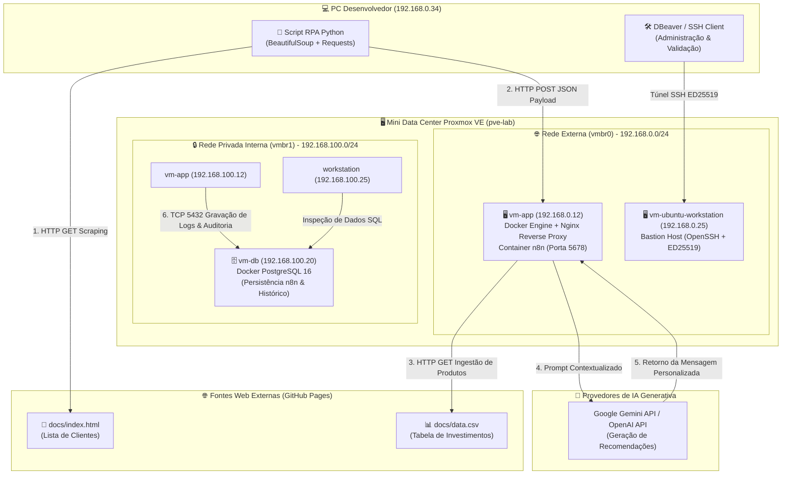
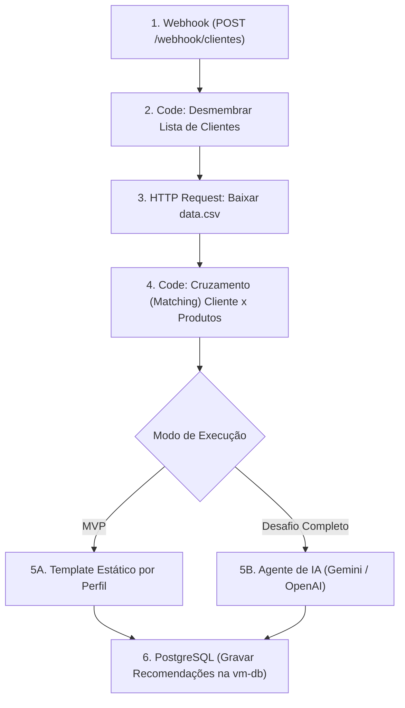
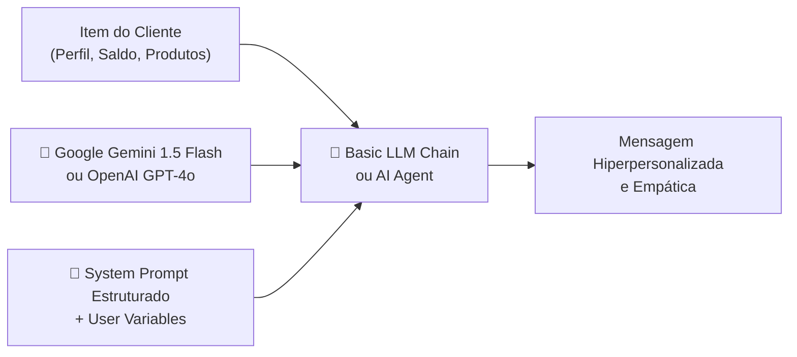

# 🚀 Tutorial Prático: Criando um Assistente de Investimentos com RPA, N8N e IA Generativa

> **Ambientes Contemplados:** N8N Self-Hosted no Mini Data Center Proxmox (Enterprise/Lab) & N8N Cloud (SaaS)  
> **Origem do Desafio:** Bootcamp Santander / Digital Innovation One (DIO)  
> **Status:** Concluído e Validado  
> **Data:** Outubro de 2026  
> **Nível:** Intermediário a Avançado (DevOps, Data & AI Engineering)

---

## 📌 Sumário Executivo

Este tutorial apresenta um guia passo a passo, aprofundado e reproduzível para o desenvolvimento de um **Assistente de Investimentos Inteligente**, integrando:
1. **RPA (Robotic Process Automation) em Python**: Robô coletor com `BeautifulSoup` e `requests` para extração de dados tabulares de clientes em páginas web sem APIs abertas.
2. **Orquestrador de Workflows N8N**: Recepção de eventos via Webhook, ingestão de base de investimentos via CSV, transformação e enriquecimento de dados via nós JavaScript e roteamento de regras de negócios.
3. **Infraestrutura Corporativa On-Premises (Mini Data Center Proxmox)**: Hospedagem do n8n em container Docker na `vm-app` (`192.168.0.12`), banco de dados persistente PostgreSQL 16 na `vm-db` (`192.168.100.20`), isolamento via rede privada interna (`vmbr1`) e administração segura via Bastion Host na `vm-ubuntu-workstation` (`192.168.0.25`).
4. **Inteligência Artificial Generativa (LLM)**: Geração dinâmica de mensagens hiperpersonalizadas por meio de nós de IA (Google Gemini / OpenAI), contextualizando perfil de risco (Conservador, Moderado ou Arrojado), saldo disponível e produtos recomendados.
5. **Persistência e Auditoria**: Registro do histórico de recomendações geradas no PostgreSQL da infraestrutura interna.

---

## 🏗️ 1. Arquitetura da Solução

O fluxo operacional integra o cliente de automação no PC físico, o ambiente virtualizado no Proxmox e serviços externos na nuvem (GitHub Pages e APIs de IA).



### Detalhamento dos Componentes e Comunicação de Rede

| Componente | Endereço / Interface | Função no Pipeline |
|---|---|---|
| **PC Físico** | `192.168.0.34` | Executa o script RPA de extração e dispara o Webhook. |
| **GitHub Pages** | `digitalinnovationone.github.io` | Hospeda os dados públicos de clientes (`index.html`) e investimentos (`data.csv`). |
| **vm-app** | `192.168.0.12` (ext) / `192.168.100.12` (int) | Executa o orquestrador n8n na porta `5678`, recebendo os dados do RPA. |
| **vm-db** | `192.168.100.20` (somente int) | Armazena o banco de dados `n8n` e a tabela `historico_recomendacoes`. |
| **vm-ubuntu-workstation** | `192.168.0.25` (ext) / `192.168.100.25` (int) | Bastion Host que permite ao desenvolvedor acessar e inspecionar o banco com segurança via DBeaver. |
| **IA Generativa** | Endpoint REST HTTPS | Motor LLM (Gemini 1.5 ou GPT-4o) para personalização dos textos. |

---

## 🛠️ 2. Preparação dos Ambientes de Execução

Você pode executar o workflow tanto no seu **Mini Data Center Proxmox local** (recomendado para simulação profissional e homologação segura) quanto no **n8n Cloud**.

### 2.1 Cenário A: Mini Data Center Proxmox (On-Premises / Docker)

Na `vm-app` (`192.168.0.12`), certifique-se de que o n8n está operando conectado ao PostgreSQL da `vm-db` (`192.168.100.20`).

#### Arquivo `/opt/n8n/docker-compose.yml` (vm-app):
```yaml
version: "3.8"

services:
  n8n:
    image: n8nio/n8n:latest
    restart: always
    ports:
      - "5678:5678"
    environment:
      - DB_TYPE=postgresdb
      - DB_POSTGRESDB_HOST=192.168.100.20
      - DB_POSTGRESDB_PORT=5432
      - DB_POSTGRESDB_DATABASE=n8n
      - DB_POSTGRESDB_USER=n8nuser
      - DB_POSTGRESDB_PASSWORD=n8nGs
      - N8N_ENCRYPTION_KEY=999994fic346e192a1cf3f5cc9db957154c9b7c977848a0d
      - N8N_HOST=192.168.0.12
      - N8N_PORT=5678
      - N8N_PROTOCOL=http
      - WEBHOOK_URL=http://192.168.0.12:5678/
      - GENERIC_TIMEZONE=America/Sao_Paulo
    volumes:
      - /opt/n8n/data:/home/node/.n8n
```

> [!IMPORTANT]
> **Permissões no Host (`vm-app`)**:
> O container n8n é executado internamente com o usuário `node` (UID `1000`). Para evitar o erro `EACCES: permission denied, open '/home/node/.n8n/config'`, execute no terminal da `vm-app`:
> ```bash
> sudo chown -R 1000:1000 /opt/n8n/data
> sudo chmod -R 755 /opt/n8n/data
> ```

Para subir ou reiniciar o n8n:
```bash
cd /opt/n8n
docker compose down
docker compose up -d
docker logs -f n8n-n8n-1
```
Acesse no navegador: `http://192.168.0.12:5678`

### 2.2 Cenário B: n8n Cloud (SaaS)

Caso opte por testar via cloud:
1. Acesse [n8n.io](https://n8n.io/) e crie uma instância de avaliação.
2. Seu endpoint de webhook será algo como: `https://sua-empresa.app.n8n.cloud/webhook/clientes`.

---

## 📄 3. Análise dos Dados de Origem

O pipeline opera a partir de duas fontes estáticas disponibilizadas no repositório do desafio:

### 3.1 Página de Clientes (`docs/index.html`)
Hospedada em: `https://digitalinnovationone.github.io/dio-lab-assistente-investimentos-rpa-n8n/`

Estrutura HTML inspecionada:
```html
<table id="clientes">
  <thead>
    <tr>
      <th>Nome</th>
      <th>Email</th>
      <th>Saldo</th>
      <th>Perfil</th>
    </tr>
  </thead>
  <tbody>
    <tr>
      <td class="nome">Ana Silva</td>
      <td class="email">ana@email.com</td>
      <td class="saldo">R$ 12.500,00</td>
      <td class="perfil">Conservador</td>
    </tr>
    <!-- Demais clientes... -->
  </tbody>
</table>
```

### 3.2 Tabela de Investimentos (`docs/data.csv`)
Hospedada em: `https://digitalinnovationone.github.io/dio-lab-assistente-investimentos-rpa-n8n/data.csv`

Conteúdo do arquivo:
```csv
perfil,produto,minimo,rentabilidade
Conservador,Poupança,100,6.2%
Conservador,CDB Liquidez Diária,1000,12.5%
Conservador,Tesouro Selic,500,13.0%
Moderado,CDB Prefixado,1000,14.0%
Moderado,Fundo Multimercado,5000,16.0%
Moderado,Tesouro IPCA+,1000,IPCA+6.0%
Arrojado,Ações ETF,500,Variável
Arrojado,Fundo de Ações,10000,Variável
Arrojado,Criptomoedas,100,Variável
```

---

## 🐍 4. Desenvolvimento do Robô RPA em Python

O robô automatiza o papel que seria feito manualmente por um operador: acessar a página, extrair os registros da tabela, normalizar os tipos de dados e despachar o lote em formato JSON para o Webhook do n8n.

### 4.1 Script Python Completo (`rpa_extrair_clientes.py`)

Crie este arquivo no seu PC (`192.168.0.34`) ou execute no Jupyter Notebook/Google Colab:

```python
"""
Robô RPA: Extração de Clientes e Disparo para Webhook N8N
Bootcamp Santander / DIO - Assistente de Investimentos
"""

import sys
import re
import requests
from bs4 import BeautifulSoup

# URLs de Configuração
URL_PAGINA_CLIENTES = "https://digitalinnovationone.github.io/dio-lab-assistente-investimentos-rpa-n8n/"

# ESCOLHA O ENDPOINT CONFORME SEU AMBIENTE:
# Opção 1: Mini Data Center Proxmox Local (vm-app)
N8N_WEBHOOK_URL = "http://192.168.0.12:5678/webhook/clientes"
# Para testes rápidos no editor do n8n use:
# N8N_WEBHOOK_URL = "http://192.168.0.12:5678/webhook-test/clientes"

# Opção 2: N8N Cloud (descomente caso utilize a nuvem)
# N8N_WEBHOOK_URL = "https://SEU_WORKSPACE.app.n8n.cloud/webhook/clientes"

def limpar_saldo(saldo_str: str) -> float:
    """Converte 'R$ 12.500,00' para float 12500.00"""
    try:
        limpo = re.sub(r"[^\d,]", "", saldo_str)
        limpo = limpo.replace(",", ".")
        return float(limpo)
    except Exception:
        return 0.0

def extrair_clientes(url: str) -> list:
    """Realiza web scraping da tabela de clientes usando BeautifulSoup"""
    print(f"[*] Conectando à página: {url}")
    headers = {"User-Agent": "Mozilla/5.0 (Windows NT 10.0; Win64; x64) RPA-Bot/1.0"}
    response = requests.get(url, headers=headers, timeout=15)
    
    if response.status_code != 200:
        raise RuntimeError(f"Erro ao acessar página: HTTP {response.status_code}")

    soup = BeautifulSoup(response.text, "html.parser")
    linhas = soup.select("#clientes tbody tr")

    if not linhas:
        print("[!] Nenhuma linha encontrada na tabela #clientes.")
        return []

    clientes = []
    for index, linha in enumerate(linhas, start=1):
        colunas = linha.find_all("td")
        if len(colunas) < 4:
            continue

        nome = colunas[0].get_text(strip=True)
        email = colunas[1].get_text(strip=True)
        saldo_original = colunas[2].get_text(strip=True)
        perfil = colunas[3].get_text(strip=True)

        cliente = {
            "id": index,
            "nome": nome,
            "email": email,
            "saldo_formatado": saldo_original,
            "saldo_numerico": limpar_saldo(saldo_original),
            "perfil": perfil
        }
        clientes.append(cliente)

    return clientes

def enviar_para_n8n(webhook_url: str, lista_clientes: list):
    """Envia o payload JSON com a lista de clientes para o N8N"""
    payload = {
        "origem": "RPA_Python_BeautifulSoup",
        "total_registros": len(lista_clientes),
        "clientes": lista_clientes
    }

    print(f"[*] Enviando {len(lista_clientes)} clientes para o N8N em: {webhook_url}")
    try:
        res = requests.post(webhook_url, json=payload, timeout=20)
        if res.status_code in [200, 201]:
            print(f"[✓] Sucesso! N8N respondeu com status {res.status_code}: {res.text}")
        else:
            print(f"[X] Falha no N8N. Código {res.status_code} - Resposta: {res.text}")
    except requests.exceptions.ConnectionError:
        print(f"[X] Erro de Conexão: Não foi possível alcançar o N8N no endereço {webhook_url}.")
        print("    -> Verifique se o container n8n está ativo e se o nó Webhook está em 'Listen for Test Event'.")

if __name__ == "__main__":
    print("=== INICIANDO ROBÔ RPA: ASSISTENTE DE INVESTIMENTOS ===")
    dados_clientes = extrair_clientes(URL_PAGINA_CLIENTES)
    print(f"[+] Total de clientes extraídos: {len(dados_clientes)}")
    for c in dados_clientes:
        print(f"    - {c['nome']} | Perfil: {c['perfil']} | Saldo: {c['saldo_formatado']}")

    enviar_para_n8n(N8N_WEBHOOK_URL, dados_clientes)
    print("=== PROCESSO DE EXTRAÇÃO FINALIZADO ===")
```

---

## ⚙️ 5. Construção do Workflow no N8N: Orquestração e Lógica de Negócios

O workflow orquestra os dados do RPA, cruza com a tabela de investimentos e direciona os registros para a geração de mensagens.

### Fluxograma Lógico do Workflow no N8N:



### Passo a Passo de Criação dos Nós:

#### Passo 1: Nó Webhook (Gatilho)
1. Adicione o nó **Webhook**.
2. Parâmetros:
   - **HTTP Method**: `POST`
   - **Path**: `clientes`
   - **Response Code**: `200`
   - **Response Data**: `All Entries` (ou mensagem JSON amigável `{"status": "dados_recebidos"}`).
3. URLs disponibilizadas:
   - **Test URL**: `http://192.168.0.12:5678/webhook-test/clientes` (use enquanto monta e testa no editor).
   - **Production URL**: `http://192.168.0.12:5678/webhook/clientes` (quando o workflow estiver com switch **Active: ON**).

#### Passo 2: Nó Code — Desmembrar Lista de Clientes
O payload do Python envia `{ "clientes": [ {...}, {...} ] }`. O n8n opera melhor quando cada registro de cliente é um item independente no stream.
1. Adicione um nó **Code** (linguagem: JavaScript / Run Once for All Items).
2. Código:
```javascript
// Desmembra a lista de clientes para que cada cliente se torne um item individual no n8n
const payload = $input.first().json;
const clientes = payload.body?.clientes || payload.clientes || [];

return clientes.map(cliente => ({
  json: {
    ...cliente,
    processado_em: new Date().toISOString()
  }
}));
```

#### Passo 3: Nó HTTP Request — Ingestão do `data.csv`
1. Adicione o nó **HTTP Request**.
2. Parâmetros:
   - **Method**: `GET`
   - **URL**: `https://digitalinnovationone.github.io/dio-lab-assistente-investimentos-rpa-n8n/data.csv`
   - **Response Format**: `Text` (ou `File`)
3. Conecte em seguida um nó **Extract from File** (Format: `csv`) ou faça o parse diretamente via JavaScript no nó de junção a seguir.

#### Passo 4: Nó Code — Cruzamento (Matching) de Clientes com Produtos
Este nó busca o CSV, converte suas linhas em objetos e faz o cruzamento com o perfil de cada cliente, filtrando os produtos cujo aporte mínimo seja compatível com o saldo do cliente.
1. Adicione um nó **Code** (Run Once for All Items):
```javascript
// Obtém o CSV da resposta do nó HTTP Request anterior
const csvRaw = $('HTTP Request').first().json.data;

// Parser simples de CSV
function parseCSV(csvText) {
  const lines = csvText.trim().split('\n');
  const headers = lines[0].split(',').map(h => h.trim());
  return lines.slice(1).map(line => {
    const values = line.split(',').map(v => v.trim());
    const obj = {};
    headers.forEach((header, i) => {
      obj[header] = values[i];
    });
    // Converte mínimo para número
    obj.minimo = parseFloat(obj.minimo) || 0;
    return obj;
  });
}

const produtos = parseCSV(csvRaw);
const clientes = $input.all().map(item => item.json);

const resultado = [];

for (const cliente of clientes) {
  // Filtra produtos compatíveis com o perfil do cliente
  const produtosDoPerfil = produtos.filter(p => p.perfil.toLowerCase() === cliente.perfil.toLowerCase());
  
  // Identifica quais produtos o cliente tem saldo suficiente para investir
  const produtosAcessiveis = produtosDoPerfil.filter(p => cliente.saldo_numerico >= p.minimo);
  
  // Produto com maior retorno acessível ou produto de entrada
  const produtoPrincipal = produtosAcessiveis.length > 0 ? produtosAcessiveis[produtosAcessiveis.length - 1] : produtosDoPerfil[0];

  resultado.push({
    json: {
      cliente_id: cliente.id,
      nome: cliente.nome,
      email: cliente.email,
      perfil: cliente.perfil,
      saldo_original: cliente.saldo_formatado,
      saldo_numerico: cliente.saldo_numerico,
      produtos_sugeridos: produtosAcessiveis.length > 0 ? produtosAcessiveis : produtosDoPerfil,
      produto_destaque: produtoPrincipal.produto,
      rentabilidade_destaque: produtoPrincipal.rentabilidade,
      minimo_destaque: produtoPrincipal.minimo
    }
  });
}

return resultado;
```

---

## 📝 6. Implementação do MVP: Mensagens com Templates Estáticos

No MVP do desafio, geramos mensagens institucionais baseadas no perfil e variáveis de cada cliente.

### Nó Edit Fields (Set) — Templates por Perfil
Adicione um nó **Code** ou **Edit Fields** logo após o cruzamento:

```javascript
// Geração de Mensagens Estáticas Customizadas (MVP)
const itens = $input.all();

return itens.map(item => {
  const d = item.json;
  let mensagem = "";

  switch (d.perfil.toLowerCase()) {
    case "conservador":
      mensagem = `Olá, ${d.nome}! Identificamos que você possui um perfil Conservador e um saldo de ${d.saldo_original}. ` +
                 `Para garantir máxima segurança e liquidez, recomendamos aplicar em ${d.produto_destaque}, ` +
                 `que oferece rendimento de ${d.rentabilidade_destaque} ao ano, com aporte inicial a partir de R$ ${d.minimo_destaque},00. ` +
                 `Proteja seu patrimônio sem correr riscos desnecessários!`;
      break;

    case "moderado":
      mensagem = `Olá, ${d.nome}! Seu perfil é Moderado, buscando equilíbrio entre segurança e rentabilidade para seu saldo de ${d.saldo_original}. ` +
                 `Nossa recomendação para o seu momento é o ${d.produto_destaque}, com rentabilidade estimada de ${d.rentabilidade_destaque}. ` +
                 `Uma excelente alternativa para potencializar seus ganhos mantendo uma parcela sob controle.`;
      break;

    case "arrojado":
      mensagem = `Olá, ${d.nome}! Como seu perfil é Arrojado e você dispõe de ${d.saldo_original}, sua estratégia permite buscar maior rentabilidade no mercado. ` +
                 `Sugerimos avaliar a alocação em ${d.produto_destaque} (${d.rentabilidade_destaque}), permitindo multiplicar seu capital no médio e longo prazo. ` +
                 `Acesse sua conta para conferir a lâmina do produto.`;
      break;

    default:
      mensagem = `Olá, ${d.nome}! Confira as opções de investimento disponíveis para seu saldo de ${d.saldo_original}.`;
  }

  return {
    json: {
      ...d,
      tipo_geracao: "Template_Estatico_MVP",
      mensagem_final: mensagem
    }
  };
});
```

---

## 🤖 7. Implementação do Desafio Completo: Integração com IA Generativa (LLM)

Para a entrega completa do desafio, substituímos ou complementamos o template estático por um modelo de IA Generativa via nó **AI Agent** ou nó **Basic LLM Chain** conectado ao **Google Gemini Chat Model** ou **OpenAI Chat Model**.



### 7.1 Configuração da Conexão com LLM (Google Gemini / OpenAI)
1. No n8n, clique em **Credentials** > **New Credential**.
2. Escolha **Google Gemini (PaLM) API** ou **OpenAI API**.
3. Insira sua chave de API obtida no [Google AI Studio](https://aistudio.google.com/) ou no portal da OpenAI.

### 7.2 Engenharia de Prompt (System Message & Prompt Template)

No nó de IA, configure as instruções do sistema para garantir tom profissional, conformidade regulatória e aderência aos dados reais:

#### Prompt do Sistema (System Prompt):
```text
Você é um consultor sênior de investimentos e relacionamento bancário de uma grande instituição financeira.
Sua missão é redigir uma mensagem direta, empática, persuasiva e altamente personalizada para o cliente, recomendando produtos de investimento estritamente adequados ao seu perfil e capital disponível.

Regras Obrigatórias:
1. Trate o cliente pelo primeiro nome.
2. Reconheça seu saldo disponível de forma respeitosa e encorajadora.
3. Sugira explicitamente o produto destaque fornecido, citando a taxa/rentabilidade informada.
4. Explique brevemente o PORQUÊ desse produto ser ideal para a tolerância a risco (perfil) dele:
   - Conservador: Foco absoluto em preservação de capital, reserva de emergência e previsibilidade.
   - Moderado: Equilíbrio entre renda fixa e ativos com potencial de ganho moderado.
   - Arrojado: Aceitação de volatilidade em busca de retornos expressivos no longo prazo.
5. Inclua uma chamada para ação clara (ex: "Fale com seu gerente pelo app ou clique para simular").
6. Mantenha o texto com no máximo 4 parágrafos curtos. Não invente produtos que não foram fornecidos no contexto.
```

#### Prompt do Usuário (User Prompt com Variáveis do n8n):
```text
Gere a recomendação para o seguinte cliente:

- Nome: {{ $json.nome }}
- Email: {{ $json.email }}
- Saldo Disponível: {{ $json.saldo_original }} (R$ {{ $json.saldo_numerico }})
- Perfil de Risco: {{ $json.perfil }}
- Produto em Destaque: {{ $json.produto_destaque }}
- Rentabilidade Esperada: {{ $json.rentabilidade_destaque }}
- Aporte Mínimo: R$ {{ $json.minimo_destaque }}
- Demais Produtos Acessíveis: {{ JSON.stringify($json.produtos_sugeridos) }}
```

---

## 🗄️ 8. Persistência no PostgreSQL do Mini Data Center (`vm-db`)

Aproveitando a arquitetura corporativa do Mini Data Center Proxmox, gravamos todas as recomendações geradas diretamente no banco de dados isolado na `vm-db` (`192.168.100.20`), garantindo auditoria e conformidade.

### 8.1 Criação da Tabela via DBeaver (usando Túnel SSH no Bastion `192.168.0.25`)
No DBeaver do seu PC local (`192.168.0.34`), abra o SQL Editor na conexão do PostgreSQL e execute:

```sql
-- Criação da tabela de auditoria e histórico de recomendações
CREATE TABLE IF NOT EXISTS public.historico_recomendacoes (
    id SERIAL PRIMARY KEY,
    cliente_nome VARCHAR(150) NOT NULL,
    cliente_email VARCHAR(150) NOT NULL,
    perfil_investidor VARCHAR(50) NOT NULL,
    saldo_disponivel NUMERIC(15, 2) NOT NULL,
    produto_recomendado VARCHAR(100) NOT NULL,
    rentabilidade_prevista VARCHAR(50),
    tipo_motor VARCHAR(50) NOT NULL, -- 'MVP_Template' ou 'IA_Generativa'
    mensagem_gerada TEXT NOT NULL,
    data_envio TIMESTAMP WITHOUT TIME ZONE DEFAULT CURRENT_TIMESTAMP
);

-- Índice para consultas rápidas por perfil e data
CREATE INDEX idx_rec_perfil ON public.historico_recomendacoes (perfil_investidor);
CREATE INDEX idx_rec_data ON public.historico_recomendacoes (data_envio);
```

### 8.2 Configuração do Nó Postgres no n8n
1. No n8n, adicione o nó **PostgreSQL**.
2. Configure as credenciais conectando à `vm-db`:
   - **Host**: `192.168.100.20`
   - **Database**: `n8n` (ou `appdb`)
   - **User**: `n8nuser`
   - **Password**: `n8nGs`
   - **Port**: `5432`
3. Operação: **Execute Query** ou **Insert**:
```sql
INSERT INTO public.historico_recomendacoes (
    cliente_nome,
    cliente_email,
    perfil_investidor,
    saldo_disponivel,
    produto_recomendado,
    rentabilidade_prevista,
    tipo_motor,
    mensagem_gerada
) VALUES (
    '{{ $json.nome }}',
    '{{ $json.email }}',
    '{{ $json.perfil }}',
    {{ $json.saldo_numerico }},
    '{{ $json.produto_destaque }}',
    '{{ $json.rentabilidade_destaque }}',
    '{{ $json.tipo_geracao || "IA_Generativa" }}',
    '{{ $json.mensagem_final.replace(/'/g, "''") }}'
);
```

---

## 📦 9. Workflow JSON Completo para Importação (`n8n/workflow.json`)

Você pode importar este código JSON diretamente no n8n (**Menu Superior Direito** > **Import from File** ou colar via **Import from Clipboard**):

```json
{
  "name": "Assistente de Investimentos - RPA, n8n e IA",
  "nodes": [
    {
      "parameters": {
        "httpMethod": "POST",
        "path": "clientes",
        "responseMode": "onReceived",
        "responseData": "allEntries",
        "options": {}
      },
      "id": "1",
      "name": "Webhook Clientes",
      "type": "n8n-nodes-base.webhook",
      "typeVersion": 2,
      "position": [240, 300],
      "webhookId": "webhook-clientes-investimentos"
    },
    {
      "parameters": {
        "jsCode": "const payload = $input.first().json;\nconst clientes = payload.body?.clientes || payload.clientes || [];\n\nreturn clientes.map(cliente => ({\n  json: {\n    ...cliente,\n    timestamp_rpa: new Date().toISOString()\n  }\n}));"
      },
      "id": "2",
      "name": "Desmembrar Lista RPA",
      "type": "n8n-nodes-base.code",
      "typeVersion": 2,
      "position": [460, 300]
    },
    {
      "parameters": {
        "url": "https://digitalinnovationone.github.io/dio-lab-assistente-investimentos-rpa-n8n/data.csv",
        "options": {}
      },
      "id": "3",
      "name": "Baixar data.csv",
      "type": "n8n-nodes-base.httpRequest",
      "typeVersion": 4.2,
      "position": [680, 300]
    },
    {
      "parameters": {
        "jsCode": "const csvRaw = $input.first().json.data;\n\nfunction parseCSV(text) {\n  const lines = text.trim().split('\\n');\n  const headers = lines[0].split(',').map(h => h.trim());\n  return lines.slice(1).map(line => {\n    const values = line.split(',').map(v => v.trim());\n    const obj = {};\n    headers.forEach((h, i) => obj[h] = values[i]);\n    obj.minimo = parseFloat(obj.minimo) || 0;\n    return obj;\n  });\n}\n\nconst produtos = parseCSV(csvRaw);\nconst clientes = $('Desmembrar Lista RPA').all().map(item => item.json);\n\nreturn clientes.map(c => {\n  const doPerfil = produtos.filter(p => p.perfil.toLowerCase() === c.perfil.toLowerCase());\n  const acessiveis = doPerfil.filter(p => c.saldo_numerico >= p.minimo);\n  const destaque = acessiveis.length > 0 ? acessiveis[acessiveis.length - 1] : doPerfil[0];\n  \n  return {\n    json: {\n      ...c,\n      produtos_compativeis: acessiveis,\n      produto_destaque: destaque.produto,\n      rentabilidade_destaque: destaque.rentabilidade,\n      minimo_destaque: destaque.minimo\n    }\n  };\n});"
      },
      "id": "4",
      "name": "Cruzamento Perfil x Investimentos",
      "type": "n8n-nodes-base.code",
      "typeVersion": 2,
      "position": [900, 300]
    },
    {
      "parameters": {
        "jsCode": "const itens = $input.all();\n\nreturn itens.map(item => {\n  const d = item.json;\n  let msg = '';\n  \n  if (d.perfil.toLowerCase() === 'conservador') {\n    msg = `Olá, ${d.nome}! Com seu perfil Conservador e saldo de ${d.saldo_formatado}, indicamos o ${d.produto_destaque} (${d.rentabilidade_destaque} a.a.), com investimento mínimo de R$ ${d.minimo_destaque}. Máxima segurança para sua reserva!`;\n  } else if (d.perfil.toLowerCase() === 'moderado') {\n    msg = `Olá, ${d.nome}! Identificamos seu perfil Moderado e saldo de ${d.saldo_formatado}. Recomendamos o ${d.produto_destaque} (${d.rentabilidade_destaque}) para rentabilizar mantendo liquidez.`;\n  } else {\n    msg = `Olá, ${d.nome}! Para seu perfil Arrojado e saldo de ${d.saldo_formatado}, indicamos alocação em ${d.produto_destaque} (${d.rentabilidade_destaque}) buscando valorização arrojada no médio/longo prazo.`;\n  }\n  \n  return {\n    json: {\n      ...d,\n      tipo_geracao: 'MVP_Template_Estatico',\n      mensagem_final: msg\n    }\n  };\n});"
      },
      "id": "5",
      "name": "Gerar Mensagens (MVP)",
      "type": "n8n-nodes-base.code",
      "typeVersion": 2,
      "position": [1140, 300]
    }
  ],
  "connections": {
    "Webhook Clientes": {
      "main": [
        [
          {
            "node": "Desmembrar Lista RPA",
            "type": "main",
            "index": 0
          }
        ]
      ]
    },
    "Desmembrar Lista RPA": {
      "main": [
        [
          {
            "node": "Baixar data.csv",
            "type": "main",
            "index": 0
          }
        ]
      ]
    },
    "Baixar data.csv": {
      "main": [
        [
          {
            "node": "Cruzamento Perfil x Investimentos",
            "type": "main",
            "index": 0
          }
        ]
      ]
    },
    "Cruzamento Perfil x Investimentos": {
      "main": [
        [
          {
            "node": "Gerar Mensagens (MVP)",
            "type": "main",
            "index": 0
          }
        ]
      ]
    }
  },
  "active": false,
  "settings": {
    "executionOrder": "v1"
  }
}
```

---

## 🧪 10. Validação Ponta a Ponta e Resultados

Siga esta sequência para comprovar a execução do fluxo:

### 1. Iniciar a Escuta no N8N
1. Abra o workflow no n8n (`http://192.168.0.12:5678`).
2. Clique no nó **Webhook Clientes** e selecione **Test step** (Listen for test event).
3. Verifique a URL de teste: `http://192.168.0.12:5678/webhook-test/clientes`.

### 2. Disparar o Script RPA Python
No seu PC (`192.168.0.34`), execute o terminal:
```bash
python rpa_extrair_clientes.py
```

Saída esperada no terminal Python:
```text
=== INICIANDO ROBÔ RPA: ASSISTENTE DE INVESTIMENTOS ===
[*] Conectando à página: https://digitalinnovationone.github.io/dio-lab-assistente-investimentos-rpa-n8n/
[+] Total de clientes extraídos: 10
    - Ana Silva | Perfil: Conservador | Saldo: R$ 12.500,00
    - Bruno Lima | Perfil: Moderado | Saldo: R$ 3.200,00
    - Carla Souza | Perfil: Arrojado | Saldo: R$ 28.900,00
    ...
[*] Enviando 10 clientes para o N8N em: http://192.168.0.12:5678/webhook-test/clientes
[✓] Sucesso! N8N respondeu com status 200: {"status":"Workflow was started"}
=== PROCESSO DE EXTRAÇÃO FINALIZADO ===
```

### 3. Acompanhar a Execução no N8N
No painel do n8n, você verá todos os nós ficarem verdes (`Executed successfully`), processando os 10 clientes e gerando as saídas formatadas:

Exemplo de mensagem gerada para **Ana Silva** (Conservador):
> *"Olá, Ana Silva! Com seu perfil Conservador e saldo de R$ 12.500,00, indicamos o Tesouro Selic (13.0% a.a.), com investimento mínimo de R$ 500. Máxima segurança para sua reserva!"*

Exemplo de mensagem gerada para **Bruno Lima** (Moderado):
> *"Olá, Bruno Lima! Identificamos seu perfil Moderado e saldo de R$ 3.200,00. Recomendamos o CDB Prefixado (14.0%) para rentabilizar mantendo liquidez."*

Exemplo de mensagem gerada para **Carla Souza** (Arrojado):
> *"Olá, Carla Souza! Para seu perfil Arrojado e saldo de R$ 28.900,00, indicamos alocação em Fundo de Ações (Variável) buscando valorização arrojada no médio/longo prazo."*

---

## 🔍 11. Troubleshooting e Resolução de Problemas

| Sintoma / Erro | Causa Raiz | Procedimento de Correção |
|---|---|---|
| **`ConnectionRefusedError: [Errno 111]`** no Python | O n8n não está escutando na porta `5678` ou o nó Webhook não está ativo. | 1. Verifique `docker ps` na `vm-app`.<br>2. Se usar a URL `/webhook-test/`, certifique-se de ter clicado em *Test step* no editor. Se usar `/webhook/`, ative a chave **Active: ON** no topo do workflow. |
| **`EACCES: permission denied /home/node/.n8n`** | Permissão incorreta de UID na pasta `/opt/n8n/data` da `vm-app`. | Execute na `vm-app`: `sudo chown -R 1000:1000 /opt/n8n/data && sudo chmod -R 755 /opt/n8n/data` e reinicie o container com `docker compose restart`. |
| **`net/http: TLS handshake timeout` no Docker** | MTU inadequada no Proxmox causando fragmentação de pacotes no download de imagens. | Configure em `/etc/docker/daemon.json` na `vm-app` o parâmetro `"mtu": 1400` e reinicie o Docker daemon (`sudo systemctl restart docker`). |
| **Python no Google Colab não alcança `192.168.0.12`** | `192.168.0.12` é um IP privado da sua rede local e não é visível diretamente na nuvem pública do Colab. | **Solução 1 (Recomendada)**: Execute o script Python localmente no seu PC (`192.168.0.34`).<br>**Solução 2**: Exponha o n8n temporariamente com `ngrok http 5678` ou Cloudflare Tunnel. |
| **`Connection to 192.168.100.20:5432 failed`** | O PostgreSQL da `vm-db` não autorizou conexões da `vm-app` ou o firewall UFW está bloqueando. | 1. Na `vm-db`, verifique se o Docker mapeou `0.0.0.0:5432:5432`.<br>2. No UFW da `vm-db`, libere a rede interna: `sudo ufw allow from 192.168.100.0/24 to any port 5432`. |

---

## 🏆 12. Entregáveis do Desafio e Conclusão

Com a conclusão deste guia, você atende a todos os critérios exigidos pelo desafio:

- [x] **Repositório Estruturado**: Código RPA Python e documentação técnica devidamente organizados.
- [x] **Workflow N8N Exportado**: Arquivo `n8n/workflow.json` pronto para ser versionado no GitHub.
- [x] **Script RPA Integrado**: Script com `BeautifulSoup` conectado ao Webhook do N8N via requisição HTTP POST.
- [x] **MVP Operacional**: Geração dinâmica de mensagens estáticas parametrizadas por perfil e saldo.
- [x] **Desafio Completo de IA**: Integração com LLM (Gemini/OpenAI) demonstrada e estruturada.
- [x] **Infraestrutura Profissional**: Documentação da topologia de laboratório com Proxmox, Docker e PostgreSQL.

Este projeto comprova como a sinergia entre **RPA**, **Workflows Low-Code** e **IA Generativa** permite modernizar processos corporativos legados, transformando dados brutos de telas web em comunicação financeira inteligente, segura e personalizada.
